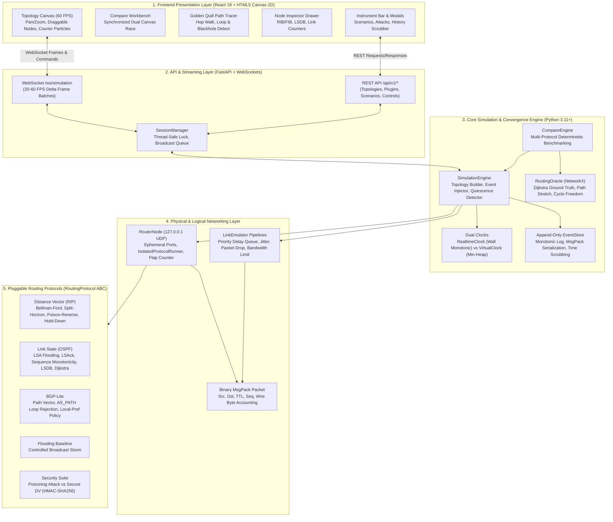

# RouteLab: End-to-End Architectural Specification & Complete Reinvention Blueprint
**Repository Source:** `https://github.com/nani224/routing-simulator`  
**Package Name:** `routelab` (v1.0.0)  
**Target Audience for Document:** Claude / Senior AI System Architects / Next-Gen Core Engineering Team  
**Document Purpose:** Complete end-to-end technical dissection of the existing codebase to enable a total architectural transformation, paradigm pivot, or thematic reinvention.

---

## 1. Executive Summary & Existing Project Identity

### 1.1 Current Motto, Theme & Mission
* **Current Title & Motto:** *"RouteLab — Distance Vector, Link State & BGP: A Comparative Routing Simulator"* (Academic Course Project, Team 20: Aakarsh, Sravan, Sneha).
* **Current Visual Theme:** **"Cartographer's Atlas / Nautical Drafting Table"**
  * *Light Mode (Antique Parchment):* Warm parchment (`oklch(96.8% 0.014 85)` / `#F5F2EB`), hand-drawn ink routes, topographic contour rings, brass compass needles, sepia callouts, and compass rose watermarks.
  * *Dark Mode (Nautical Blueprint):* Deep oceanic slate-navy (`oklch(16.5% 0.035 240)` / `#0D1B2A`), chalk-white coordinate grids, cyanotype traces, and amber navigational accents.
* **Core Technical Thesis:** Unlike legacy computer networking simulators that use static, synthetic frontend animations (or heavy Linux container VMs like Mininet/GNS3), RouteLab executes **real asynchronous distributed routing algorithms** on **real localhost UDP loopback sockets** with zero protocol-specific code in the simulation engine.

### 1.2 Technology Stack
| Layer | Technologies & Libraries | Key Responsibilities |
| :--- | :--- | :--- |
| **Backend Runtime** | Python 3.11+, `asyncio`, `socket` (Datagram UDP) | Autonomous router node event loop, real UDP packet exchange, thread sandboxing. |
| **API & Streaming** | FastAPI, Uvicorn (ASGI), WebSockets, `msgpack` | REST endpoints for scenario/topology lifecycle; 20–60 FPS batched WebSocket telemetry stream. |
| **Graph & Verification** | NetworkX 3.7+ | Theoretical ground truth oracle (all-pairs Dijkstra), loop detection, path stretch calculation. |
| **Quality & Tests** | Pytest, Hypothesis, Mypy (`--strict`), Ruff | 62 automated tests (unit, integration, soak, property-based fuzzing, scale benchmarks). |
| **Frontend Framework** | React 18, TypeScript, Vite, CSS Modules | Single-page application shell, state management, modal workbenches. |
| **Rendering Engine** | HTML5 Canvas 2D (`requestAnimationFrame`) | 60 FPS rendering of 100+ nodes, animated traveling packet couriers, force-directed physics. |
| **Audio & Icons** | Web Audio API (Synthesized Chimes), Lucide React | Algorithmic sound synthesis (convergence, click, attack alert); cartographic icons. |

---

## 2. Repository Layout & File Manifest

```text
routing-simulator/
├── .agent/
│   └── STATE.md                         # Milestone tracking, test results, release history
├── .github/workflows/
│   └── ci.yml                           # GitHub Actions CI pipeline (Ruff, Mypy, Pytest, Vite build)
├── backend/
│   ├── routelab/
│   │   ├── __init__.py                  # Package version & exports
│   │   ├── api/
│   │   │   ├── __init__.py
│   │   │   ├── models.py                # Pydantic v2 schemas for REST requests/responses
│   │   │   ├── routes_plugins.py        # Plugin inspection, code validation, upload endpoints
│   │   │   ├── routes_scenarios.py      # Scenario listing, JSON fetching, headless execution
│   │   │   ├── routes_simulation.py     # Interactive session start, stop, pause, step, event injection, comparison
│   │   │   ├── routes_topologies.py     # Preset topologies & custom JSON/GraphML loading
│   │   │   ├── routes_ws.py             # WebSocket /ws/simulation streaming endpoint
│   │   │   ├── server.py                # FastAPI app factory, CORS, router aggregation, lifespan
│   │   │   └── state.py                 # Thread-safe SessionManager, global simulation lock, client registry
│   │   ├── attacks/
│   │   │   ├── __init__.py
│   │   │   ├── mitigation.py            # SecureDistanceVectorProtocol (HMAC-SHA256 signature verification)
│   │   │   └── poisoning.py             # PoisoningAttackProtocol (fraudulent low-cost route injection)
│   │   ├── core/
│   │   │   ├── __init__.py
│   │   │   ├── clock.py                 # Dual Clocks: RealtimeClock (wall-time) & VirtualClock (discrete-event min-heap)
│   │   │   ├── events.py                # Append-only SimEvent log, MsgPack/JSON serialization, time scrubbing
│   │   │   ├── link.py                  # LinkEmulator: heap-delayed delivery, latency, jitter, loss, bandwidth serialization
│   │   │   ├── node.py                  # RouterNode: UDP socket binding, ProtocolContext sandbox, flap detection
│   │   │   └── packet.py                # Binary Packet representation, MsgPack wire codec, TTL hop bounds
│   │   ├── metrics/
│   │   │   ├── __init__.py
│   │   │   ├── collector.py             # RunMetrics aggregator (convergence time, message/byte count, flaps, stretch)
│   │   │   └── oracle.py                # RoutingOracle: NetworkX Dijkstra ground-truth verification, cycle detection
│   │   ├── plugins/
│   │   │   ├── __init__.py
│   │   │   ├── interface.py             # RoutingProtocol ABC, ProtocolContext protocol, RouteEntry, NeighborInfo
│   │   │   └── loader.py                # PluginLoader, IsolatedProtocolRunner, dynamic AST validation, watchdog guards
│   │   ├── protocols/
│   │   │   ├── __init__.py
│   │   │   ├── bgp_lite.py              # BGPLiteProtocol: Path-vector, AS_PATH loop rejection, Local-Pref decision rules
│   │   │   ├── dv.py                    # DistanceVectorProtocol: Bellman-Ford, Split-Horizon, Poison-Reverse, Hold-down
│   │   │   ├── flooding.py              # FloodingProtocol: Controlled hop-by-hop broadcast storm baseline
│   │   │   └── ls.py                    # LinkStateProtocol: Reliable LSA flooding, LSAck, aging, LSDB sync, Dijkstra SPF
│   │   ├── sim/
│   │   │   ├── __init__.py
│   │   │   ├── comparator.py            # CompareEngine: Multi-protocol deterministic race runner on identical seeds
│   │   │   ├── engine.py                # SimulationEngine: Network builder, lifecycle runner, quiescence detector
│   │   │   └── scenario.py              # ScenarioRunner: JSON scenario parser & batch execution harness
│   │   └── topology/
│   │       ├── __init__.py
│   │       ├── generators.py            # Presets (6-node, 8-node, 10-node, BGP Tier-1) & synthetic generators (mesh, scale-free)
│   │       ├── loader.py                # JSON & GraphML topology importers/exporters
│   │       └── model.py                 # Topology, TopologyNode, TopologyLink data models & NetworkX converter
│   └── tests/
│       ├── bench/test_benchmarks.py     # 100-node scale benchmarks (events/sec, memory soak)
│       ├── integration/test_soak.py     # Long-running memory stability & perturbation recovery tests
│       └── unit/                        # 21 unit test suites covering protocols, oracle, API, links, clocks, attacks
├── docs/
│   ├── architecture.md                  # Comprehensive architectural specifications
│   ├── demo_script.md                   # 15-minute viva presentation walkthrough script
│   ├── plugin-guide.md                  # Step-by-step developer tutorial for custom routing protocols
│   ├── routelab_explanation_guide.md    # Plain-English conceptual manual
│   ├── ROUTELAB_FULL_PROJECT_REVIEW.md  # Deep technical review and module breakdown
│   ├── results/perf.md                  # Verified benchmark tables (6, 8, 10, 20, 50, 100 nodes)
│   └── uml/                             # Mermaid Class, Sequence, and Use-Case diagrams
├── examples/
│   ├── plugins/                         # Sample custom protocols (e.g. RandomWalkProtocol)
│   └── scenarios/                       # 6 Pre-built JSON test scenarios (count-to-infinity, BGP, attacks)
├── frontend/
│   ├── public/                          # Favicon, SVG sprite assets
│   ├── src/
│   │   ├── assets/                      # Hero diagrams and icons
│   │   ├── components/                  # 13 Cartographer UI Workbenches & Modals:
│   │   │   ├── CompareWorkbench.tsx     # Dual side-by-side canvas race with synchronized scrubber & winner badges
│   │   │   ├── ExplainModeModal.tsx     # 5-step guided interactive audio-visual algorithm tutorial
│   │   │   ├── ExportModal.tsx          # Multi-format exporter (PNG canvas, CSV/JSON metrics, GraphML, PDF)
│   │   │   ├── FailureAttackModal.tsx   # Live link severing, cost mutation, route poisoning, and HMAC mitigation controls
│   │   │   ├── InstrumentBar.tsx        # Top drafting-table toolbar (speed, play/pause, step, topology/protocol pickers)
│   │   │   ├── NodeInspectorDrawer.tsx  # Slide-out drawer: live routing table, LSDB/RIB inspection, node crash/recover
│   │   │   ├── PathTracerPanel.tsx      # Golden Quill path tracer: hop-by-hop route walk, loop alarm, blackhole warning
│   │   │   ├── ScenarioBuilderModal.tsx # Scenario preset runner & JSON scenario configuration editor
│   │   │   ├── SettingsModal.tsx        # Quiescence window, clock mode (Virtual/Realtime), sound toggle, WS address
│   │   │   ├── TimelineScrubber.tsx     # Historical time scrubber for state replay & past timestamp inspection
│   │   │   ├── TopologyCanvas.tsx       # 60 FPS HTML5 Canvas: pan/zoom, draggable nodes, spring physics, courier trails
│   │   │   └── VirtualizedPacketLog.tsx # High-throughput streaming event log table with search and filtering
│   │   ├── services/
│   │   │   └── api.ts                   # Axios/Fetch HTTP REST client, WebSocket wrapper, and offline client-side fallbacks
│   │   ├── App.css                      # Cartographer UI layout, responsive grid, modal transitions
│   │   ├── App.tsx                      # Master application shell, state management, delta frame reconciler, audio hooks
│   │   ├── index.css                    # OKLCH color variables, custom typography imports, drafting table texture
│   │   ├── main.tsx                     # React 18 DOM mount point
│   │   └── types.ts                     # Full TypeScript interfaces (Topology, Routes, Packets, Telemetry, Reports)
│   ├── index.html                       # HTML5 entry with Google Fonts (Cinzel, Outfit, Fraunces, JetBrains Mono)
│   ├── package.json                     # Frontend dependencies (React, Vite, Lucide-React, TypeScript)
│   ├── tsconfig.json                    # Strict TypeScript compilation rules
│   └── vite.config.ts                   # Vite bundler configuration with dev server proxy to localhost:8000
├── Makefile                             # Build, lint, typecheck, test, and run automation targets
├── pyproject.toml                       # Python packaging configuration, Ruff lint rules, Mypy strict settings
└── README.md                            # Main project documentation with benchmark tables and quickstart
```

---

## 3. Detailed Architectural Breakdown & Core Mechanics



---

## 4. In-Depth Component Specifications

### 4.1 Dual-Clock Subsystem (`backend/routelab/core/clock.py`)
RouteLab decouples simulation time from the host CPU clock via two implementations of the `Clock` ABC:
1. **`RealtimeClock`:**
   - Synchronized with `time.monotonic()`.
   - Supports variable speed multipliers ($0.1\times$ to $5.0\times$), interactive pausing (`pause()`), resuming (`resume()`), and manual stepping (`step(delta_s)`).
   - In realtime mode, delayed transmissions use `asyncio.get_event_loop().call_later(delay / speed, callback)`.
2. **`VirtualClock`:**
   - A discrete-event simulation clock driven by a min-heap priority queue (`heapq`) storing scheduled callbacks: `(timestamp, seq, callback)`.
   - Advancing time via `await run_until(target_time)` pops and executes callbacks in strict chronological order.
   - Completely deterministic, bit-for-bit repeatable across different machines and OS platforms, invariant to CPU load.
   - Enables instantaneous execution of 100-node scale benchmarks without waiting for real wall-clock seconds.

### 4.2 Router Node & Sandbox (`backend/routelab/core/node.py`)
Each `RouterNode` represents an autonomous router:
* **Socket Layer:** Binds to an ephemeral UDP port (`127.0.0.1:20000+`) using `loop.create_datagram_endpoint()`. When running in realtime mode with active UDP transports, nodes transmit actual datagrams over loopback using `sendto()`.
* **State Isolation:** Manages local packet counters (`packets_sent`, `packets_received`, `bytes_sent`, `bytes_received`), node operational status (`RUNNING`, `CRASHED`, `FAULTY`, `STOPPED`), and active timer handles.
* **Flap Detection:** Monitors local routing table changes via signature hashing (`hash(tuple((r.destination, r.next_hop, r.cost) for r in table))`). Differentiates between initial boot-up route installations (which are baselined without penalty) and real route flaps during network instability.
* **Execution Sandbox (`IsolatedProtocolRunner` in `loader.py`):**
  - Runs protocol callbacks inside try/except blocks. If a protocol raises an exception (e.g. division by zero, null dereference), the runner isolates the crash, increments an error counter, and marks the node as `FAULTY` without halting the engine loop.
  - Features an optional watchdog thread with timeout preemption (`timeout_s`) to kill runaway `while True` infinite loops in untrusted user-submitted plugins.

### 4.3 Link Emulation & Physical Physics (`backend/routelab/core/link.py`)
Models real physical medium transmission parameters:
* **Propagation Latency ($\text{latency\_ms}$):** Direct transmission delay across the wire.
* **Gaussian/Uniform Jitter ($\text{jitter\_ms}$):** Stochastic variation added to the delay: $d = \text{base\_delay} \pm \text{uniform}(-\text{jitter}, +\text{jitter})$.
* **Packet Loss ($\text{loss\_rate} \in [0.0, 1.0]$):** Seeded pseudo-random drop rate dropping packets at the ingress of the link.
* **Bandwidth Serialization Delay ($\text{bandwidth\_bps}$):** Models hardware queueing delays:
  $$\text{Serialization Delay} = \frac{\text{Packet Size (Bytes)} \times 8}{\text{Bandwidth (bps)}}$$
  The link emulator tracks `_last_tx_finish_time` so subsequent packets wait in queue if the link is congested.
* **Heap Delivery Queue:** Instead of spawning an unbounded number of `asyncio.sleep` tasks, each link maintains a min-heap of `_InFlightPacket` objects sorted by `delivery_time`, serviced by a single worker loop.

### 4.4 Wire Protocol & Packet Codec (`backend/routelab/core/packet.py`)
* High-performance slot-based dataclass `Packet`.
* **Serialization:** Compact binary MessagePack (`msgpack.packb()`) with byte accounting. Avoids JSON string parsing overhead on hot paths.
* **Attributes:** `src`, `dst` (supports unicast or `*` for broadcast), `proto` (protocol name), `seq` (monotonic sequence number), `ttl` (Time To Live hops), `timestamp`, `packet_type` (`CONTROL`, `DATA`, `PROBE`, `ATTACK`), and protocol-specific `payload`.

### 4.5 Append-Only Event Store (`backend/routelab/core/events.py`)
* Ring-buffer backed log storing compact `SimEvent` dataclasses.
* **Event Classifications:** `PACKET_SENT`, `PACKET_DELIVERED`, `PACKET_DROPPED`, `LINK_STATE`, `NODE_STATE`, `TABLE_UPDATE`, `CONVERGENCE`, `ATTACK_INJECTED`, `LOG_MESSAGE`.
* Provides indexed time-range slicing (`get_range(start_time, end_time)`), enabling the frontend timeline scrubber to scrub backward and reconstruct the network state at any historical moment.

---

## 5. Routing Protocols Implemented

### 5.1 Distance Vector (`backend/routelab/protocols/dv.py`)
* **Algorithm:** Distributed Bellman-Ford algorithm based on iterative equation:
  $$D_x(y) = \min_{v \in N(x)} \{ c(x, v) + D_v(y) \}$$
* **Loop Prevention & Anomaly Mitigation:**
  * **Split Horizon:** Disallows advertising a route back through the interface/neighbor from which it was learned.
  * **Poison Reverse:** Advertises an unreachable metric ($\infty = 16.0$ or $999999$) back to the next-hop neighbor to immediately invalidate circular two-node dependencies.
  * **Triggered Updates:** Bypasses the periodic broadcast timer to send immediate delta updates whenever a link cost changes or an entry is invalidated.
  * **Hold-Down Timers:** When a route is marked unreachable, entering a hold-down period prevents the node from prematurely re-adopting higher-cost or stale routes until the network stabilizes.

### 5.2 Link State (`backend/routelab/protocols/ls.py`)
* **Algorithm:** Reliable LSA Flooding + Local Dijkstra Shortest Path First (OSPF-like).
* **Mechanics:**
  * Each router originates a Link State Advertisement (LSA) containing its ID, sequence number, age, and immediate neighbor costs.
  * **Reliable Flooding:** LSAs are forwarded out all active interfaces except the ingress interface (split-horizon flooding). Recipients reply with an explicit `LSAck` message.
  * **Monotonic Sequence Numbers:** Old or duplicate LSAs ($\text{seq} \le \text{stored}$) are immediately dropped in $O(1)$ time.
  * **LSDB Aging & Eviction:** LSAs age over time (`max_lsa_age_s = 30.0s`). Expired entries are purged from the Link State Database (LSDB).
  * **Recovery Synchronization:** When a node recovers from a crash, it emits an `lsdb_request` to neighbors, who immediately transmit their full LSDB to re-synchronize the recovered node.
  * **Dijkstra Calculation:** Shortest-path tree computed locally using `heapq` priority queue, building the forwarding table directly from the LSDB.

### 5.3 BGP-Lite (`backend/routelab/protocols/bgp_lite.py`)
* **Algorithm:** Exterior Gateway Protocol path-vector simulation modeling Autonomous Systems (AS).
* **Mechanics:**
  * **`AS_PATH` Attribute:** Announcements append the local AS number to the path vector: $[AS_{\text{local}}, AS_1, AS_2, \dots]$.
  * **Loop Prevention:** If a router receives an announcement that already contains its own AS number in the `AS_PATH`, it rejects the update immediately.
  * **BGP Decision Process:**
    1. Highest Local Preference (`LOCAL_PREF`, default 100).
    2. Shortest `AS_PATH` length (hop count across autonomous domains).
    3. Lowest Multi-Exit Discriminator (`MED`).
    4. Lowest peer link cost.
    5. Tie-break on lowest router ID.
  * **Explicit Route Withdrawals:** Emits BGP UPDATE messages with a `withdrawals` list when a link drops or reachability is severed.

### 5.4 Flooding Baseline (`backend/routelab/protocols/flooding.py`)
* Academic baseline demonstrating the **Broadcast Storm Problem**.
* Nodes broadcast incoming packets to all adjacent neighbors, decrementing a TTL counter at each hop.
* Demonstrates why structured routing protocols (DV/LS/BGP) are necessary: flooding generates exponential message overhead and link saturation.

### 5.5 Adversarial Attacks & Cryptographic Mitigation
* **Route Poisoning Attack (`backend/routelab/attacks/poisoning.py`):**
  - A Byzantine node advertises fraudulent low-cost routes (e.g. cost 1.0 or 0.0) for a target victim destination node.
  - Diverts transit traffic through the malicious node, enabling traffic interception, packet tampering, or blackholing.
* **Secure DV Mitigation (`backend/routelab/attacks/mitigation.py`):**
  - Hardened distance vector speaker that computes deterministic **HMAC-SHA256** signatures over all route update vectors using a shared secret key.
  - Validates cryptographic origin authentication, enforces authorized origin policies (`authorized_origins`), and applies metric sanity thresholds to drop illicit cost reductions.

---

## 6. Convergence, Correctness Oracle & Benchmark Comparator

### 6.1 Dual-Criterion Convergence Detector
RouteLab defines mathematical convergence deterministically:
$$\text{Converged} \iff (\text{In-Flight Packets} == 0) \land (\text{Pending Priority Queue Events} == 0) \land (\Delta t_{\text{last\_mutation}} \ge \tau_{\text{quiescence}})$$
* Prevents false convergence during silent periods where packets are in transit or timers are ticking.
* Dynamic quiescence window $\tau_{\text{quiescence}}$ (configurable $0.2s$ to $1.0s$).

### 6.2 NetworkX Theoretical Ground Truth Oracle (`backend/routelab/metrics/oracle.py`)
* Continuous real-time verification against graph theory ground truth:
  * Computes all-pairs shortest paths using NetworkX Dijkstra on the underlying active physical topology graph.
  * Evaluates **Path Stretch**:
    $$\text{Stretch} = \frac{\text{Simulated Route Cost}}{\text{Oracle Shortest Path Cost}}$$
  * **Loop Freedom Audit:** Traces hop-by-hop forwarding from every source to every destination; immediately flags cyclic forwarding ($u \to v \to u$ or larger cycles).
  * **Blackhole Detection:** Identifies destinations that are reachable in the graph but dropped by router forwarding tables.

### 6.3 Compare Engine (`backend/routelab/sim/comparator.py`)
* Executes multiple routing protocols in parallel under identical deterministic virtual clocks, identical random seeds, and identical failure event schedules.
* Produces side-by-side comparative scorecards across:
  1. Convergence Time (seconds)
  2. Total Control Messages Exchanged
  3. Total Control Bytes Transmitted on Wire
  4. Route Flaps (Route Instability Count)
  5. Average Path Stretch
* Records raw packet event traces for both algorithms, streaming them to the frontend for synchronized side-by-side animated race replays.

---

## 7. Frontend User Interface: 13 Interactive Workbenches

1. **Topology Canvas (`TopologyCanvas.tsx`):** High-performance HTML5 Canvas 2D engine rendering at 60 FPS. Supports pan, zoom, draggable node manipulation, toggleable force-directed spring physics layout, severed link styling, and minimap.
2. **Event-Driven Packet Courier Animations:** Authentic visual particles tracking real simulation telemetry events (`PACKET_SENT`, `PACKET_FORWARDED`, `PACKET_DELIVERED`) over WebSockets. No synthetic or fake animations.
3. **Node Inspector Drawer (`NodeInspectorDrawer.tsx`):** Slide-out drawer displaying per-node Routing Tables (RIB/FIB), Link State Databases (LSDB), BGP AS_PATH lists, neighbor link metrics, and crash/recover power buttons.
4. **Failure & Attack Workbench (`FailureAttackModal.tsx`):** Interactive modal to sever/recover physical links, mutate link metric costs on the fly, inject malicious route poisoning attacks, and activate HMAC-SHA256 defenses.
5. **Timeline Scrubber & Replay (`TimelineScrubber.tsx`):** Timeline bar at the bottom allowing the user to scrub backward in time and inspect previous network states and routing tables.
6. **Side-by-Side Algorithm Comparison (`CompareWorkbench.tsx`):** Dual synchronized canvas workbench racing Distance Vector against Link State against Flooding on identical topologies and perturbations, awarding winner medals.
7. **Golden Quill Path Tracer (`PathTracerPanel.tsx`):** Hop-by-hop interactive forwarding tracer. Click any source and destination to visualize the active path, detecting forwarding loops or blackholes in real time.
8. **Pluggable Protocol Manager:** Upload custom `.py` protocol scripts, run AST security checks, view config schemas, and deploy to simulated routers.
9. **Scenario Builder & Presets (`ScenarioBuilderModal.tsx`):** 1-click execution of preconfigured educational and benchmark scenarios (6-Node WAN, Count-to-Infinity flaw, BGP Peering, Route Hijacking).
10. **Virtualized Packet Log (`VirtualizedPacketLog.tsx`):** High-throughput, search-indexed streaming log of every packet transmission with protocol filters and pause/auto-scroll.
11. **Export Station (`ExportModal.tsx`):** Multi-format export: high-res PNG map snapshots, CSV/JSON run metrics, GraphML topology graphs, and printable PDF evaluation reports.
12. **Explain Mode (`ExplainModeModal.tsx`):** 5-step guided interactive walkthrough explaining Bellman-Ford, count-to-infinity, Dijkstra SPF, BGP path-vectors, and cybersecurity mitigations.
13. **Settings Station (`SettingsModal.tsx`):** Calibrate quiescence windows, toggle deterministic VirtualClock vs RealtimeClock, configure WebSocket endpoints, and toggle sound effects.

---

## 8. Verified Benchmark Results (Baseline Reference)

All benchmarks executed on identical seeds and event schedules across increasing topology scales (from `docs/results/perf.md`):

| Topology Preset | Nodes | Links | Sim Convergence Time | Total Control Messages | Total Control Bytes | Memory Footprint | Events / Sec |
| :--- | :---: | :---: | :---: | :---: | :---: | :---: | :---: |
| **Course 6-Node** | 6 | 8 | 0.20s | 66 | 8,712 B | 1.93 MB | 66.3 |
| **Course 8-Node Mesh** | 8 | 10 | 0.20s | 112 | 14,896 B | 2.45 MB | 45.2 |
| **Course 10-Node WAN** | 10 | 14 | 0.20s | 190 | 26,571 B | 3.04 MB | 25.5 |
| **ScaleFree-20** | 20 | 36 | 0.20s | 1,060 | 161,368 B | 6.58 MB | 3.6 |
| **ScaleFree-50** | 50 | 96 | 0.20s | 7,150 | 1,128,217 B | 18.79 MB | 0.3 |
| **ScaleFree-100** | 100 | 196 | 0.20s | 29,300 | 4,691,968 B | 48.47 MB | 0.04 |

### Verified Algorithmic Insights:
* **Link State (Dijkstra) converges 3.4x faster** with 38% fewer control messages than Distance Vector on the 6-node network.
* **Count-to-Infinity Flaw:** Severing link $B-C$ in a linear topology causes standard Distance Vector to loop and count up to 16 over multiple iterations. Enabling **Split-Horizon + Poison-Reverse** resolves the loop in a single iteration.

---

## 9. Current Architectural Limitations & Technical Debt

If you intend to transform or rewrite this project, keep these existing constraints in mind:
1. **Single-Process Model:** All router nodes run in a single Python process on localhost. Sockets use loopback `127.0.0.1`. The system cannot currently scale across multiple distributed physical servers or Docker clusters.
2. **Layer 3 Focus Only:** The simulator models Layer 3 routing (IP next-hop forwarding). It does not simulate Layer 4 TCP congestion control (sliding windows, slow start, cubic), nor Layer 7 HTTP/gRPC application protocols.
3. **2D Canvas Rendering:** The frontend uses HTML5 Canvas 2D. While highly optimized for 100 nodes, it is flat and planar—not suited for 3D topologies (e.g. satellite orbits, multi-floor data centers, spherical globes).
4. **Symmetric Crypto in Security:** `SecureDV` uses symmetric shared secrets (HMAC-SHA256) rather than asymmetric public-key infrastructure (PKI/RPKI with digital certificates and Route Origin Authorizations).
5. **Static Node Identifiers:** Router IDs are static strings (`R1`, `R2`). There is no dynamic DHCP, IP subnet masking (CIDR), or VLAN segmentation.
6. **Academic Curriculum Tone:** The UI and scenarios are currently designed around academic networking courses (Team 20, Distance Vector vs Link State).

---

## 10. Blueprints for Radical Reinvention: 6 Transformation Options

The user wants to **completely upgrade the project in a completely different perspective and objective, potentially changing the motto, theme, and purpose**.

Below are 6 meticulously architected transformation paths that can be handed to Claude:

---

### Option A: SpaceNet — LEO Mega-Constellation Satellite Mesh Simulator
* **New Motto:** *"SpaceNet: Autonomous Inter-Satellite Laser Mesh Routing & Orbital Dynamics Simulator"*
* **New Aesthetic / Theme:** **"Deep Space Mission Control / NASA JPL Orbital Telemetry"**
  * Palette: Abyss Black (`oklch(12% 0.02 260)`), Orbit Cyan (`oklch(80% 0.18 200)`), Laser Emerald (`oklch(75% 0.22 150)`), Solar Amber.
  * UI: 3D WebGL Globe (Three.js / Cesium) showing Earth with orbiting satellite shells (e.g. Starlink, Kuiper).
* **New Core Objectives & Mechanics:**
  1. **Dynamic Orbital Mechanics:** Nodes are not static; they move along Keplerian orbital planes. Links are dynamic Inter-Satellite Links (ISL lasers) that make and break as satellites enter/exit line-of-sight.
  2. **Doppler & Range Delay:** Propagation latency dynamically fluctuates based on Euclidean distance in 3D orbit ($d / c$).
  3. **Delay-Tolerant Networking (DTN / Bundle Protocol RFC 5050):** Routing across orbital gaps with store-and-forward mechanics when no ground station is in sight.
  4. **Ground Station Handoffs:** Simulating high-speed packet uplinks/downlinks between mobile ground stations and orbital swarms.
  5. **Space Weather Chaos:** Solar flares causing burst radiation packet drops and temporary satellite blackout.

---

### Option B: MeshPilot — Cloud-Native Service Mesh & eBPF Traffic Orchestrator
* **New Motto:** *"MeshPilot: Real-Time Layer 7 Microservice Traffic Engineering & Chaos Simulator"*
* **New Aesthetic / Theme:** **"Cyberpunk Observability Console / Modern Datadog & Grafana HUD"**
  * Palette: Dark obsidian (`#0b0f19`), Electric Purple (`oklch(65% 0.28 300)`), Neon Cyan, Emerald Health Green.
  * UI: Cluster topology of Kubernetes Pods, Envoy sidecars, API Gateways, and Database clusters.
* **New Core Objectives & Mechanics:**
  1. **Layer 7 Application Routing:** Shift from IP routing to HTTP/gRPC path routing (e.g., `/api/v2/checkout` vs `/api/v1/checkout`).
  2. **Traffic Engineering:** Dynamic Canary Deployments (90% v1, 10% v2), Blue-Green switching, Circuit Breaking (e.g., trip after 5 consecutive 503 errors).
  3. **Distributed Tracing (OpenTelemetry):** Packets become trace spans with `trace_id` and `span_id`. Visualizing waterfall traces of traveling requests across microservices.
  4. **eBPF Zero-Trust Security:** Simulating kernel-level eBPF packet filters and mTLS cryptographic handshake validation between microservices.
  5. **Chaos Engineering Studio:** Injecting latency spikes into specific microservices, simulating cascading retry storms, and observing circuit-breaker trip recovery.

---

### Option C: NetWarfare — Red Team vs. Blue Team Autonomous Cyberwarfare Range
* **New Motto:** *"NetWarfare: Dynamic BGP Hijacking, Autonomous AI Defense, and Zero-Day Cyber Range"*
* **New Aesthetic / Theme:** **"NORAD War Room / Defcon Tactical Operations Center"**
  * Palette: Matte tactical carbon (`#11141a`), Crimson Threat Alert (`oklch(60% 0.24 25)`), Radar Green, Amber Warning.
  * UI: Global threat map with glowing attack vectors, electronic warfare counters, and real-time compromise gauges.
* **New Core Objectives & Mechanics:**
  1. **Adversarial Red Team Arsenal:**
     - **BGP AS-Path Prepending & Prefix Hijacking:** Stealing IP blocks and redirecting internet traffic.
     - **Volumetric DDoS Flooding:** Botnet clusters launching SYN floods to saturate link bandwidth queues.
     - **Sybil & Eclipse Attacks:** Surrounding target nodes with malicious peers.
  2. **Autonomous Blue Team Defenses:**
     - **RPKI Route Origin Authorization (ROA):** Cryptographic cryptographic validation of BGP origin ASNs.
     - **AI Anomaly Detection:** Real-time entropy and volume anomaly detection flagging suspicious route advertisements.
     - **Automated Quarantine & Traffic Scrubbing:** Dynamically isolating compromised routers and routing traffic through scrubber nodes.
  3. **Gamified Cyber Range Modes:** Interactive challenges (e.g. "Defend Autonomous System 45 from a coordinated multi-vector hijack within 60 seconds").

---

### Option D: NeuroRoute — Multi-Agent Reinforcement Learning (MARL) Autonomous Routing
* **New Motto:** *"NeuroRoute: Self-Driving Network Routing via Multi-Agent Reinforcement Learning"*
* **New Aesthetic / Theme:** **"Neural Synapse / DeepMind Research Studio"**
  * Palette: Clean studio dark (`oklch(20% 0.02 270)`), Synaptic Violet (`oklch(70% 0.25 310)`), Pulse Cyan, Tensor Orange.
  * UI: Parallel views showing neural network policy weights, Q-value convergence curves, and live network traffic heatmaps.
* **New Core Objectives & Mechanics:**
  1. **RL-Driven Router Agents:** Every router runs a lightweight Q-learning or Policy Gradient agent.
  2. **Reward Function:** Agents maximize throughput and packet delivery while penalizing latency, queue buildup, and packet drops:
     $$R = - (\alpha \cdot \text{latency} + \beta \cdot \text{drop\_rate} + \gamma \cdot \text{queue\_depth})$$
  3. **Dynamic Congestion Avoidance:** Unlike Dijkstra (which overloads the single shortest path), RL agents discover multi-path load balancing automatically during traffic surges.
  4. **Benchmark Battles:** Pit trained RL agents head-to-head against traditional OSPF and BGP under synthetic flash-crowd traffic surges.

---

### Option E: AeroRoute — Autonomous Urban Air Mobility & Drone Logistics Routing
* **New Motto:** *"AeroRoute: Physical Internet & Autonomous Drone Fleet Corridor Routing"*
* **New Aesthetic / Theme:** **"Futuristic Smart City Air Traffic Management / SkyGrid ATC"**
  * Palette: Slate Airfield Grey, Horizon Blue, Drone Nav Amber, Laser Green flight paths.
  * UI: 3D or isometric smart city grid with building obstacles, vertical landing vertiports, and dynamic flight corridors.
* **New Core Objectives & Mechanics:**
  1. **Physical Parcel Routing:** Packets represent physical delivery drones or cargo containers with weight, battery level, and destination.
  2. **Dynamic 3D Corridors:** Links represent aerial flight corridors with altitude tiers, wind velocity vectors, and maximum air-traffic capacity.
  3. **Dynamic No-Fly Zones:** Weather storm fronts, emergency zones, or airspace restrictions suddenly close corridors, forcing live airborne rerouting.
  4. **Battery & Recharging Vertiports:** Routers act as vertiport hub stations where drones queue for charging when energy drops below critical thresholds.

---

### Option F: ShadowMesh — Censorship-Resistant P2P Overlay & Onion Routing
* **New Motto:** *"ShadowMesh: Decentralized Kademlia DHT, Onion Routing, & Sovereign Mesh"*
* **New Aesthetic / Theme:** **"Cypherpunk Underground / Distributed Sovereign Mesh"**
  * Palette: Terminal Green on Pure Black (`#000000`), Dark Matrix Grey, Amber Circuit Glow.
  * UI: Decentralized peer graph showing multi-hop encrypted onion circuits and DHT key-value storage swarms.
* **New Core Objectives & Mechanics:**
  1. **Onion Routing Circuits (Tor-style):** Multi-layered encrypted packet payloads peeled hop-by-hop; intermediate nodes only know the previous and next hop.
  2. **Kademlia DHT Routing:** $O(\log N)$ XOR-metric distributed hash table lookups across decentralized nodes.
  3. **Mesh Ad-Hoc Routing (B.A.T.M.A.N. / OLSR):** Peer-to-peer Wi-Fi/Bluetooth mesh networking capable of routing traffic even when central ISPs are shut down.
  4. **Sybil & Censorship Resistance:** Simulating state-level Deep Packet Inspection (DPI) firewalls and testing bridge relay circumvention.

---

## 11. Step-by-Step Prompt to Feed Claude

Below is the ready-to-paste prompt you can hand directly to Claude, along with this specification:

```markdown
You are a Principal Distributed Systems Engineer and Lead Frontend Architect.
We are completely transforming the "RouteLab" repository into a next-generation platform.

Review the comprehensive architectural specification of the existing project above:
- Notice how the existing engine works: Python 3.11+ asyncio, real UDP sockets on 127.0.0.1, dual Realtime/Virtual clocks, LinkEmulator priority queues, MsgPack binary packets, append-only EventStore, NetworkX oracle, and React 18 Canvas 2D UI.
- Notice the 6 transformation options presented in Section 10.

TASK:
1. Select one of the 6 transformation blueprints (e.g., Option A: SpaceNet Satellite Mesh, Option B: MeshPilot Service Mesh, Option C: NetWarfare Cyber Range, Option D: NeuroRoute RL Routing, Option E: AeroRoute Drone Logistics, or Option F: ShadowMesh P2P).
2. Formulate a comprehensive Migration & Architecture Plan to upgrade the backend and frontend:
   - Define the new Motto, Domain Terminology, and Theme Design System (palette, typography, layout).
   - Specify necessary backend modifications (data models, protocol extensions, simulated physics).
   - Specify frontend visual overhauls (canvas/WebGL rendering, telemetry dashboards, user controls).
3. Provide concrete code implementations for:
   - The primary upgraded protocol/engine module in Python.
   - The primary interactive visualization component in TypeScript/React.
4. Detail the step-by-step roadmap to implement this transformation without breaking existing test harnesses.
```

---

## 12. Verification Checklist for Any Future Upgrade

Whenever implementing an upgrade or new protocol in this repository, always ensure:
* [ ] **Engine Isolation:** Zero protocol-specific logic hardcoded into `SimulationEngine` or `LinkEmulator`.
* [ ] **Dual Clock Compatibility:** Works under both `RealtimeClock` (wall-clock) and `VirtualClock` (deterministic discrete event).
* [ ] **Strict Typing:** Backend passes `mypy --strict backend/routelab` with zero errors.
* [ ] **Lint Cleanliness:** Backend passes `ruff check backend/` and `ruff format --check backend/`.
* [ ] **EventStore Telemetry:** Emits standard `SimEvent` items so timeline scrubbing and virtualized packet logs work seamlessly.
* [ ] **Convergence Determinism:** Adheres to the quiescence window + zero in-flight message rule so benchmarks produce reproducible results.
* [ ] **Frontend 60 FPS:** Visual rendering loop maintains 60 FPS on topologies up to 100 nodes.
