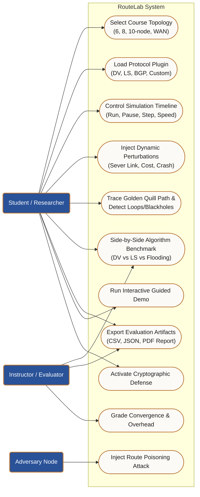

# RouteLab — Use Case Model

This document outlines the core actors and interactions supported by RouteLab for students, instructors, and network algorithm researchers.

## Actor Descriptions

- **Student / Researcher**:
  - Tests distance vector, link state, and BGP routing convergence under identical network conditions.
  - Interactively severs links or crashes nodes to observe failover behavior.
  - Inspects per-node routing tables, Link State Databases (LSDB), and AS_PATH attributes.
  - Develops custom protocol plugins adhering to the `RoutingProtocol` ABC.

- **Instructor / Evaluator**:
  - Executes standardized course scenarios (6/8/10 node topologies).
  - Grades protocol correctness against the NetworkX shortest-path oracle.
  - Evaluates message overhead, convergence duration, byte footprint, and route flaps.

- **Adversary Node**:
  - Simulates a compromised router injecting forged distance vectors with cost 1 to poison routing tables and hijack traffic.
